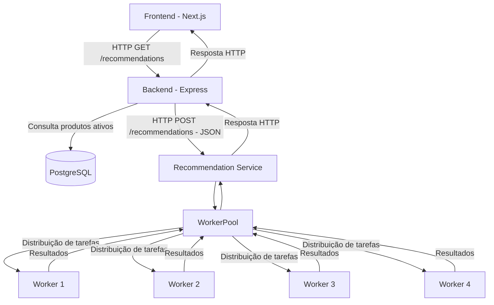

# Arquitetura Distribuída — Manoa Recommendation Service

## 1. Visão geral

O projeto Manoa utiliza uma arquitetura composta por diferentes componentes responsáveis pela interface, gerenciamento das funcionalidades da aplicação e processamento de recomendações de produtos.

O processamento de recomendações foi separado do backend principal em um serviço independente, desenvolvido com Node.js. Essa separação permite que a tarefa computacional seja executada isoladamente, utilizando Worker Threads para distribuir o processamento entre diferentes threads.

A comunicação entre o frontend, o backend e o serviço de recomendação ocorre por meio de requisições HTTP, enquanto a comunicação entre o serviço de recomendação e seus Workers utiliza troca de mensagens da API `worker_threads` do Node.js.

## 2. Componentes e responsabilidades

### 2.1. Frontend — Next.js

Responsável pela interface utilizada pelos usuários e pela solicitação das recomendações.

O hook `useRecommendations` utiliza o `recommendationService` para solicitar os produtos recomendados ao backend por meio de uma requisição HTTP GET.

O frontend também possui uma estratégia alternativa de cold start, utilizada quando o serviço não retorna recomendações ou ocorre uma falha na solicitação.

Principais arquivos:
- `frontend/src/hooks/use-recommendations.ts`
- `frontend/src/services/recommendationService.ts`
- `frontend/src/services/api.ts`
- `frontend/src/services/endpoints.ts`

### 2.2. Backend — Node.js, TypeScript e Express

Responsável pelas regras da aplicação, pelo acesso aos dados e pela integração com o serviço de recomendação.

Quando recebe uma solicitação de recomendações, o backend consulta os produtos ativos por meio do `ProductRepository`, utilizando Prisma para acessar o PostgreSQL.

Em seguida, envia os produtos ao Recommendation Service por meio de uma requisição HTTP POST, contendo os dados em formato JSON.

Principais arquivos:
- `backend/src/server.ts`
- `backend/src/app.ts`
- `backend/src/routes/recommendation.routes.ts`
- `backend/src/services/recommendation.service.ts`

### 2.3. Recommendation Service

Serviço independente desenvolvido em JavaScript com Node.js, responsável pelo processamento do algoritmo de recomendação.

Ele recebe os produtos enviados pelo backend, valida os dados recebidos e distribui o processamento entre os Workers.

Após a conclusão das tarefas, reúne os resultados, ordena as recomendações pela pontuação e retorna a resposta ao backend.

Principais arquivos:
- `recommendation-service/src/server.cjs`
- `recommendation-service/src/recommendation-engine.cjs`

### 2.4. WorkerPool e Worker Threads

O WorkerPool gerencia a distribuição das tarefas entre os Workers.

Os produtos são divididos em blocos, e cada Worker recebe:
- Um bloco de produtos para processar.
- O catálogo completo como referência para calcular as similaridades.

Cada Worker executa o algoritmo de recomendação de forma independente e envia os resultados de volta ao processo principal por meio de mensagens.

Principais arquivos:
- `recommendation-service/src/worker-pool.cjs`
- `recommendation-service/src/workers/scoring.worker.cjs`

## 3. Diagrama da arquitetura

## 4. Comunicação entre os componentes

A comunicação distribuída ocorre em duas etapas principais.

**Primeira etapa — Frontend e Backend**

O frontend realiza uma requisição HTTP GET para o endpoint `/recommendations`, enviando o parâmetro `limit`, que determina a quantidade desejada de recomendações.

O backend recebe a solicitação, valida o limite e executa a consulta dos produtos ativos no banco de dados.

**Segunda etapa — Backend e Recommendation Service**

Após consultar os produtos, o backend envia uma requisição HTTP POST para o endpoint `/recommendations` do serviço independente.

Os dados são transmitidos em formato JSON, permitindo que o serviço de recomendação processe os produtos sem precisar acessar diretamente o banco de dados.

O serviço distribui as tarefas entre os Workers e, após reunir os resultados, retorna as recomendações ao backend.

## 5. Justificativa da separação arquitetural

A separação do processamento de recomendações em um serviço independente foi adotada para isolar uma atividade computacionalmente intensiva das demais responsabilidades do backend.

O cálculo de similaridade entre produtos exige diversas comparações dentro do catálogo. À medida que a quantidade de produtos aumenta, o volume de operações também cresce.

Manter esse processamento isolado permite utilizar Worker Threads para distribuir a carga computacional, evitando concentrar toda a execução na thread principal do serviço de recomendação.

Além disso, a comunicação por HTTP permite que o backend e o serviço de recomendação mantenham responsabilidades distintas, com contratos de comunicação definidos.

Essa organização também permite evoluir o processamento de recomendações independentemente das demais funcionalidades da aplicação.

## 6. Estratégia de processamento paralelo

O Recommendation Service utiliza a API `worker_threads` do Node.js.

O WorkerPool divide os produtos em blocos e encaminha as tarefas disponíveis aos Workers.

Cada Worker executa o algoritmo de recomendação para seu bloco, considerando o catálogo completo como referência.

O algoritmo utiliza:
- TF-IDF para representar os produtos por meio de seus atributos textuais.
- Similaridade de cosseno para comparar os produtos.
- Pontuação final baseada em similaridade de conteúdo, avaliação e disponibilidade em estoque.

### Complexidade computacional

O algoritmo realiza comparações entre os produtos do catálogo para calcular suas similaridades. Dessa forma, sua complexidade de comparação é quadrática, representada por O(N²), em que N corresponde à quantidade de produtos.

Por exemplo, para um catálogo com 5.000 produtos, são realizadas até 24.995.000 comparações direcionadas entre produtos.

A divisão dos produtos em blocos permite distribuir essas operações entre diferentes Workers, reduzindo o tempo de execução observado nos experimentos de benchmark.

Os resultados são enviados de volta ao processo principal, reunidos e ordenados pela pontuação final.

A avaliação comparativa entre processamento sequencial e paralelo está documentada em `benchmarks/README.md`.

## 7. Considerações e limitações

O serviço de recomendação não acessa diretamente o PostgreSQL. A consulta dos produtos é responsabilidade do backend principal.

Na implementação atual, cada Worker recebe o catálogo completo e realiza sua própria preparação dos vetores TF-IDF. Isso gera repetição de processamento e transferência de dados entre o processo principal e os Workers.

A arquitetura também depende da disponibilidade do Recommendation Service para executar o processamento distribuído. O frontend possui uma estratégia local de cold start como alternativa quando a solicitação não retorna recomendações.

A avaliação de desempenho e as limitações dos experimentos estão detalhadas no documento de benchmark.

## 8. Principais arquivos da arquitetura

| Arquivo | Responsabilidade |
|---|---|
| `backend/src/routes/recommendation.routes.ts` | Endpoint de recomendações |
| `backend/src/services/recommendation.service.ts` | Integração HTTP com o serviço independente |
| `recommendation-service/src/server.cjs` | Servidor HTTP do serviço |
| `recommendation-service/src/worker-pool.cjs` | Gerenciamento e distribuição das tarefas |
| `recommendation-service/src/workers/scoring.worker.cjs` | Execução do processamento em cada Worker |
| `recommendation-service/src/recommendation-engine.cjs` | Algoritmo de recomendação |
| `recommendation-service/src/benchmark.cjs` | Comparação de desempenho |
